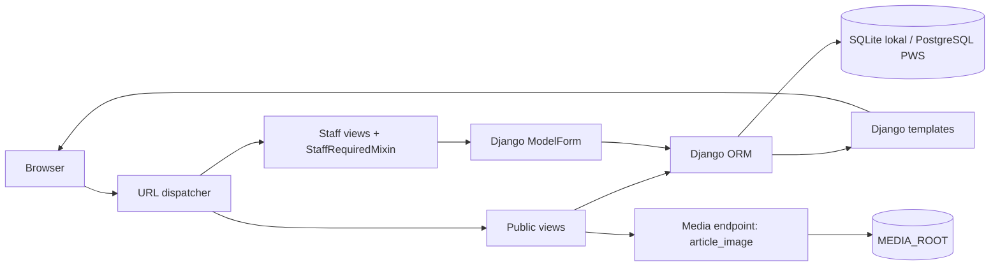
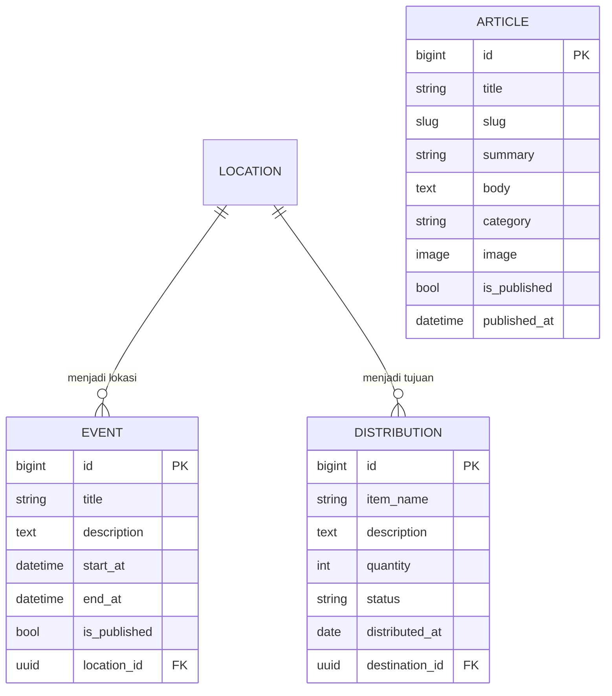
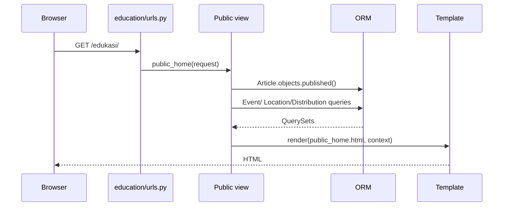
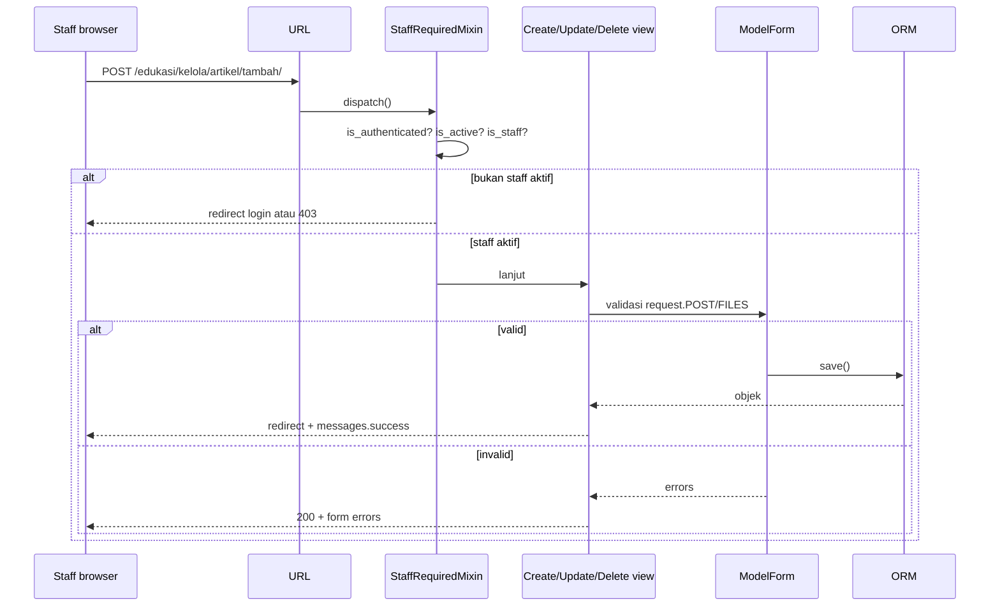
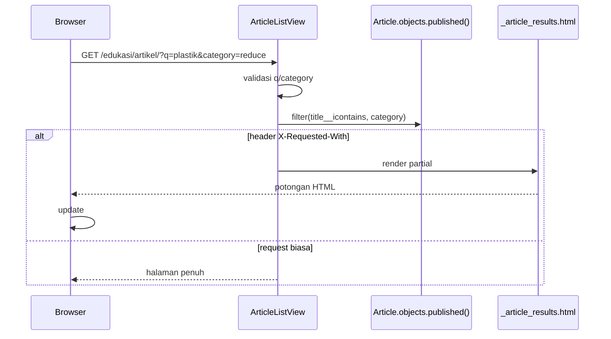
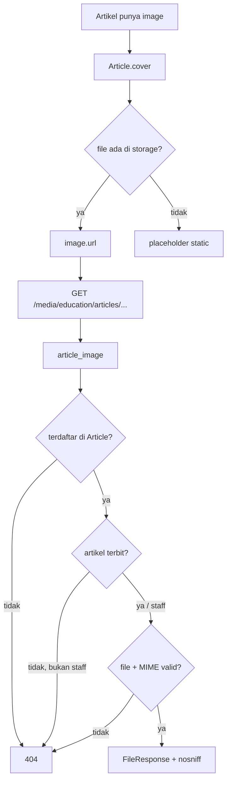

# Arsitektur Modul Education

## 1. Gambaran umum

Education adalah Django app yang menyediakan tiga entitas konten (`Article`, `Event`,
`Distribution`) dan dua jalur akses:

1. **Publik** — hanya membaca konten yang sudah diterbitkan.
2. **Staff** — CRUD melalui dashboard `/edukasi/kelola/`.

Modul ini menggunakan pola Django standar: URL dispatcher → view → form/ORM → template.
Tidak ada service layer, repository pattern, atau framework frontend tambahan. Interaksi
asynchronous memakai Fetch API vanilla, bukan HTMX.

## 2. Model dan relasi

### Article

- `title`, `summary`, `body`: konten utama.
- `slug`: unik; dibuat dari judul saat pertama kali disimpan; tidak berubah saat judul
  diedit agar URL lama tidak rusak.
- `category`: `panduan`, `reuse`, `reduce`, `kebiasaan`.
- `image`: `ImageField` opsional; divalidasi ukuran, ekstensi, format asli, dan dimensi.
- `is_published` + `published_at`: artikel dianggap publik hanya jika keduanya memenuhi
  `ArticleQuerySet.published()`.
- `cover`: property yang mengembalikan URL gambar/placeholder dan alt text.

### Event

- `start_at` wajib, `end_at` opsional.
- `clean()` dan `CheckConstraint` menolak `end_at < start_at`.
- `location` memakai `on_delete=PROTECT`; lokasi yang dipakai agenda tidak dapat dihapus.
- Agenda publik hanya yang `is_published=True` dan `start_at >= now` untuk daftar;
  detail agenda yang sudah lewat tetap dapat dibuka jika sudah terbit.

### Distribution

- `quantity` minimal 1 (`MinValueValidator` + `CheckConstraint`).
- `destination` memakai `PROTECT`; tujuan harus panti asuhan atau komunitas.
- Status: `planned`, `delivered`, `cancelled`.
- Status `delivered` wajib memiliki `distributed_at`.
- Halaman publik hanya menampilkan status `delivered`, tanggal sudah lewat,
  dan tujuan kategori panti/komunitas.

### Location

`Location` berasal dari app lain. Field yang dipakai Education: `name`, `category`,
`address`, `city`, `province`, `open_hours`, `latitude`, `longitude`, dan `is_active`.
Education tidak mengubah model Location.

## 3. Alur request

### 3.1 Halaman publik

- `/edukasi/` memakai `public_home`.
- `/edukasi/artikel/` memakai `ArticleListView`.
- `/edukasi/artikel/<slug>/` memakai `ArticleDetailView` dengan queryset `published()`.
- `/edukasi/agenda/` memakai `EventListView` dengan event terbit dan belum lewat.
- `/edukasi/agenda/<pk>/` memakai `EventDetailView`; detail event terbit bisa dibuka.
- `/edukasi/penyaluran/` memakai `DistributionListView` + `public_distributions()`.

Jika artikel draf atau terjadwal diminta lewat URL detail, queryset tidak menemukannya
sehingga Django mengembalikan 404.

### 3.2 Dashboard pengguna staff

`StaffRequiredMixin` adalah satu-satunya pintu authorization untuk seluruh view
management. Tombol yang disembunyikan di template bukan pengganti pemeriksaan ini.

### 3.3 Filter artikel dan respons parsial

Tanpa JavaScript, form GET pada halaman tetap mengirim query string dan menerima
halaman penuh. AJAX tidak mengubah kebijakan publikasi; queryset tetap dimulai dari
`Article.objects.published()`.

### 3.4 Async delete dashboard

Tautan hapus tetap mengarah ke halaman konfirmasi. JavaScript di dashboard memakai
`fetch` POST dengan CSRF dan header `X-Requested-With`. `ManageDeleteView` memeriksa
`StaffRequiredMixin`, menghapus objek, lalu mengembalikan JSON untuk request async.
Jika item terakhir terhapus, halaman dimuat ulang agar empty state tampil.

## 4. Form dan validasi

| Form | Dipakai | Validasi penting |
|---|---|---|
| `ArticleForm` | artikel create/update | field wajib, kategori, image validator, publish date |
| `EventForm` | agenda create/update | waktu, lokasi aktif, model `clean()` untuk end >= start |
| `DistributionForm` | penyaluran create/update | jumlah, tujuan panti/komunitas, status + tanggal |

`ModelForm` memanggil validasi field, `clean()` form, lalu `Model.clean()` (melalui
`_post_clean`). Karena itu aturan bisnis di model tetap berlaku saat form disimpan.
View generic hanya memanggil `form.is_valid()` dan `form.save()`; tidak ada validasi
duplikat di view.

## 5. Template dan aset

- `templates/base.html`: header/navbar, flash messages, footer.
- `templates/education/public_*.html`: halaman publik.
- `templates/education/manage_*.html`: dashboard, form, dan konfirmasi delete.
- `static/css/education.css`: layout Education; memuat aturan publik dan dashboard.
- `static/js/education.js`: progressive reveal saat section masuk viewport.
  Tanpa JS atau dengan `prefers-reduced-motion`, konten tetap tampil.

Create/update form memakai submission HTML biasa dan redirect Django. Filter artikel
dan hapus data dashboard memiliki progressive enhancement Fetch API; tanpa JavaScript,
keduanya tetap memakai GET form dan halaman konfirmasi biasa.

## 6. Media dan gambar

Artikel memakai `ImageField` dengan storage default (filesystem `MEDIA_ROOT`).
URL yang dihasilkan adalah `/media/education/articles/YYYY/MM/<file>`.

`article_image` tidak membaca path sembarang dari `MEDIA_ROOT`: path harus berada di
prefix artikel dan harus cocok dengan nilai `Article.image` di database. Detail
keamanan ada di [security-and-validation.md](security-and-validation.md).

## 7. Impor konten publik PWS

Management command `import_pws_public_content` membaca manifest
`education/management/commands/pws_public_content.json`, lalu melakukan upsert
berdasarkan slug/nama natural key dan alias lokal. Command mendukung `--dry-run`,
memakai `transaction.atomic()`, dan memverifikasi SHA-256 gambar sebelum mengaitkannya.

Import bukan bagian request web dan tidak dijalankan otomatis saat server start.

## 8. Keputusan desain yang perlu dijelaskan saat demo

- Memakai class-based generic views agar CRUD konsisten dan sedikit kode.
- Memisahkan aturan bisnis di `Model.clean()` agar berlaku pada form dan pemanggilan
  model lain.
- Memakai `published()` queryset sebagai satu sumber kebenaran status publik.
- Memakai `PROTECT` untuk relasi lokasi agar data historis tidak kehilangan tujuan.
- Menyajikan media lewat endpoint sempit karena PWS tidak menyediakan media server
  yang terverifikasi; bukan route blanket ke seluruh `MEDIA_ROOT`.
- Memakai Fetch API tipis untuk filter dan hapus, bukan HTMX, agar dependency tetap
  minimal dan form GET/POST biasa tetap menjadi fallback.
- Create/update tetap full-page karena mempertahankan generic view dan FormData yang
  sudah teruji; belum ada kebutuhan untuk mengganti seluruh alur.
- Login staff sekarang diarahkan ke `accounts:login` agar konsisten dengan aplikasi
  dan tidak terkesan memakai Django Admin sebagai pintu CRUD.
